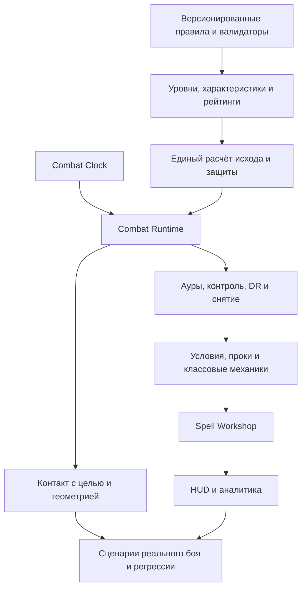

# Task 17. Аудит и последовательность доработки

Исходная проверенная версия Task 15.1 — b37d56037e7d268d7a4edfde2050da4f65f466f7. Перед Task 17 сохранено исправление изоляции способностей baf4687. Работа Task 17 ведётся в отдельном worktree, ветка codex/complete-wow-combat-simulator. Архивы, базы и модели исходной копии сохраняются.

## Состояние при начале Task 17

| Система | Наличие и ограничения |
|---|---|
| Единый расчёт | calculation-engine.js вычисляет семь школ урона, лечение, коэффициенты AP/SP/оружия, крит и снижение урона |
| Боевой runtime | combat-runtime.js управляет ресурсами, применением, периодическими эффектами, журналом и проками |
| Время | advance обрабатывает ближайшие границы тиков, каналов, регенерации и cooldown. Все они привязаны к combatTime |
| Пространство | spatial-combat.js подтверждает контакт и стены, затем вызывает runtime для расчёта урона |
| Характеристики | Есть пять основных статов, пользовательские формулы, экипировка и проценты haste. Рейтингов Cataclysm нет |
| Версия правил | Текущие константы брони 4000 и resistance 4000 — модель Talent Forge. Mastery и Versatility применяются универсально. Это требует отдельного профиля версии |
| Ресурсы | Есть произвольные шкалы и затраты, генерация, регенерация, распад. Раздельного восстановления рун нет |
| Попадание | Крит есть, отдельной таблицы miss/dodge/parry/block/glancing пока нет |
| Экипировка | Реализованы 17 слотов, две руки, ranged и ограничения. Нет комплектов и специальной модели рейтингов |
| Автоатака | Две руки, дальняя доставка, отдельные таймеры и GCD. Нужна проверка новых правил попадания |
| Применение | Instant, melee, cast, channel, straight/homing/arc, ground, area, zones. Нет очереди и pushback |
| Ауры | DoT, HoT, модификаторы, стеки, независимые экземпляры, refresh/replace/extend/keep. Нет категорий dispel, контроля и DR |
| Защита | Броня, сопротивления и щиты с приоритетом. Нет immunity, отражения, dodge/parry/block |
| Проки | Есть seed, шанс, ICD, условия, затраты и защита от рекурсии. Цепочки ограничены одним поколением |
| Билды | Сохранение талантов/экипировки, переключение и сравнение измерений. Старые документы сохраняют ID |
| Мастерская | Общий редактор всех существующих эффектов, визуальный изолированный preview, глубокое копирование экземпляров |
| HUD | HP, основной ресурс, ауры, cast/channel, cooldown/заряды, журнал, damage meter и аналитика |
| Аналитика | Есть CSV/JSON, сравнение, damage/healing/absorbed/resources/procs. Нужны полные исходы попадания, фильтры и графики |
| Классы | 82 предварительных шаблона для десяти классов. Стойки, формы и специфические механики ещё не моделируются полностью |

Исходные регрессии изоляции — 246 Node.js и 82 Python. Два мага проверены через браузер с повторным запуском HTTP-сервера и Chromium. Тесты с настоящими GLB выполняются отдельными сценариями.

## Зависимости

## Порядок проверки

Каждая фаза опирается на предыдущую. Сначала проверяются изменения состояния и журнал в runtime, затем сохранение документа в Python, затем входные пути редактора и реальный бой в Chromium/WebGL2. Существующие тесты Task 12–15 и проверка двух магов служат регрессиями.

Cataclysm должен быть явно выбранным профилем правил. Старые документы продолжают использовать прежнюю модель Talent Forge. Значения, которые не подтверждены исходными данными, будут обозначаться как параметры симулятора.

## Контрольная точка ядра и профиля правил

Добавлен явный выбор модели Talent Forge / Cataclysm 4.3.4. Профиль задаёт класс, уровень цели, позицию атаки и масштаб рейтингов. Изменение AP от основной характеристики различается по классам. В Cataclysm отключены универсальные множители Mastery/Versatility предыдущего симулятора.

Подтверждены сценарии таблицы miss/dodge/parry/block/glancing, пробивание сопротивления, применение рейтинга меткости и единичное разрешение снаряда. Входящий контрольный удар использует ту же таблицу уклонения, парирования и блока.

Константы рейтингов взяты для уровня 85. Для других уровней отображается предупреждение о масштабе симулятора. Формула брони ниже 81, блок-рейтинг, таблица атак и сопротивление остаются приближениями симулятора. Специфические эффекты искусности ещё требуют настройки по специализациям. Значения профиля не являются полной таблицей прогрессии Blizzard.

Проверки контрольной точки — 252 Node.js, 83 Python. Chromium/WebGL2 загрузил четыре настоящие модели, подтвердил 191 урона с масштабированием от интеллекта после контакта снаряда, стоимость, cooldown и единый темп боя 0.5×. Пауза сохранила показание Combat Clock.
