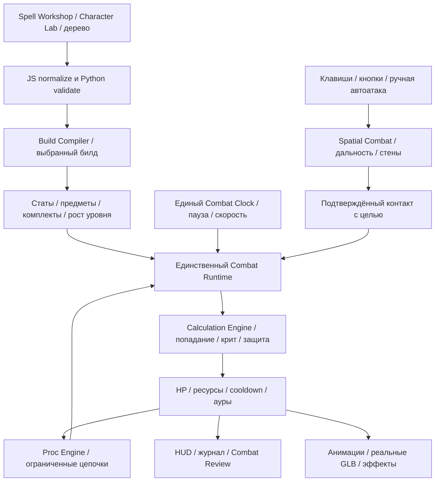

# Task 17 — боевой конструктор и проверка реализации

Рабочая ветка — `codex/complete-wow-combat-simulator`. Отдельный worktree — `/workspace/talentforge-task17`. Основа Task 15.1 — `b37d56037e7d268d7a4edfde2050da4f65f466f7`. Сначала сохранена изоляция экземпляров в `baf4687a1abc8fc4d2d62593cfecdd6fb65e1313`, затем контрольная точка правил и времени `5c67e68c9c5b95d7fd25d18d91a254cde7b0a8a8`.

Сохранены один управляемый герой, один манекен и существующая сцена. Новые игровые сущности, локации и серверы многопользовательской игры не добавлялись. Исходный worktree и приватный репозиторий ассетов сохранены. Новые изменения не публиковались.

Эта сборка расширяет конструктор боевых механик. Полная достоверная модель всех специализаций Blizzard Cataclysm остаётся отдельным незавершённым слоем данных. Ниже разделены исполняемые механики, проверки и ограничения.

## Архитектура



Математика урона остаётся в `calculation-engine.js`. Runtime отвечает за состояние, оплату, временные границы, ауры и события. Пространственный движок подтверждает дальность, видимость и попадание. Завершение графического эффекта само по себе не является расчётом урона.

## Исполняемые механики

| Область | Реализация и проверка |
|---|---|
| Время | Единый combatTime для cast, channel, GCD, cooldown, аур, рун, проков и входящего сценария. Пауза и скорости 0.25–4×. В настоящей сцене проверена скорость 0.5× и пауза |
| Правила | Явный профиль Talent Forge / Cataclysm 4.3.4. Старые документы сохраняют прежний расчёт. Рейтинги, hit, expertise, dodge, parry, block, glancing, armor и spell penetration подключены к существующему расчёту |
| Характеристики | Основные параметры, экипировка, таланты, классовый AP, интеллект/SP/мана, выносливость/HP. Дополнительный авторский рост по уровням хранится отдельно от базовых статов |
| Урон | Семь школ, физический и магический урон, weapon/AP/SP scaling, диапазон величины, крит, периодические эффекты, bleed с обходом брони, итоговый cap. Bleed, cap со щитом и модификатор стойки проверены в настоящей сцене |
| Ресурсы | Стоимость и генерация, восстановление в бою и после пяти секунд без действий, процент от максимума, бесплатное применение по ауре, расход этой ауры только при выполнении, финишер от потраченных очков. Стоимость и оплата сохраняют единый engine |
| Классовые шкалы | Десять наборов ресурсов. Holy Power, Combo Points, shards, Eclipse, Shadow Orbs, Maelstrom, три пары рун. У нового DK создаются шесть типизированных рун. Старый агрегированный пул сохраняется в существующих документах |
| Применение | Сохранены instant, cast, channel, melee, projectile, homing, ground/area/zone, прерывание, дальность и LoS. Добавлены очередь последних 0.4 с и Cataclysm pushback до двух попаданий |
| GCD и cooldown | GCD при начале cast в профиле Cataclysm, нижняя граница после haste, off-GCD, заряды, последовательное восстановление, снижение и сброс cooldown |
| Руны | Раздельные школы восстанавливаются одновременно, две потраченные руны одной пары — последовательно. Таймеры видны на HUD. В сцене проверено 0 → 1 → 2 и единичная оплата |
| Лечение | Прямое, критическое, HoT, overheal, усиление и снижение получаемого лечения. В классовых сценах и RPG-регрессии проверены реальные изменения здоровья |
| Ауры | Длительность, тики, snapshot, refresh/replace/extend/keep/independent, стаки, снятие, dispel categories, removable и break-on-damage. Haste периодических эффектов включается явно и фиксирует интервал при наложении |
| Контроль | Stun, root, slow, fear, silence, disarm, interrupt, immunity и knockback. Группы DR задаёт автор. Проверены 4/2/1/immune, root на WASD, cleanse, иммунитет и физическое отбрасывание с коллизией |
| Защита | Броня, сопротивления, избегание, блок, щиты по цели и школе, приоритет и доля поглощения, отражение, снижение критического урона. Щит не тратится при избегании |
| Состояния | Формы, стойки, аспекты, печати и режимы. Можно ограничить способность состоянием и привязать бонусы/проки к состоянию. При выходе из состояния условные бонусы перестают действовать |
| Проки | Шанс, ICD, cadence, последовательные криты, source/school/attack filters, приоритет, лимит зарядов, opt-in chains. Глубина до четырёх, запрет повторения правила в пути и бюджет 64 на исходное событие. В сцене проверены цепочка и прок после двух критов |
| Таланты | Модификаторы урона, лечения, стоимости, cast time, cooldown, duration, period, max stacks, proc chance и генерации. Есть требование уровня таланта. Бонусы пересчитываются по выбранному билду |
| Предметы | Сохранены 17 слотов, руки, скорость и урон оружия. Добавлены классовое требование, комплекты и их бонусы. Авторский случайный разброс статов воспроизводится по seed, хранит исходные значения и не накапливается при повторном броске |
| Автоатака | Сохранены отдельные таймеры оружия и GCD, ranged/melee доставка и ручное включение/выключение. Проверена в настоящей сцене у каждого из десяти классов |
| Режимы | Normal, DPS, HPS, Survival, Rotation, Resource, Ability используют общий движок. Presets задают длительность/seed/измерения. HPS и Survival могут подавать управляемые входящие удары с заданным интервалом. AI манекена не создаётся |
| Журнал | Источник, цель, школа, исход, базовая/модифицированная/итоговая величина, крит, mitigation, shield, ресурсы и ауры. Фильтры, раскрываемые подробности, CSV/JSON. Исправлен порядок ID при pushback и channel |
| Аналитика | Сохранены сравнение попыток и детализация по способностям/школам/аурам/прокам. Добавлены avoidance и block/glancing, miss rate, DPS/HPS по секундам, peak и отдельная входящая защита |
| HUD | Четыре ленты аур, таймеры и стаки, тип снятия/контроля в подсказках, подсветка окончания, поглощение, дополнительные ресурсы/руны, состояние класса. Физический урон белый, магия жёлтая, лечение зелёное, absorb голубой |
| Расположение | Режим Edit interface переносит рамки героя/цели, hotbars, cast bar и meter. Координаты сохраняются отдельно для проекта. Проверено повторное открытие арены. Выход в обычный Combat view восстанавливает его layout |

## Изоляция данных

Каждое добавление из библиотеки или дублирование создаёт новый UUID и глубокую копию. Связанные бонусы, проки и их зависимые способности получают новые ID. Ссылки cooldown и proc source переназначаются на копии. Зависимые способности активируются вместе с владельцем экземпляра и удаляются вместе с ним.

Личная библиотека Workshop и избранное сохраняют независимые снимки. Импорт в класс с другими ID ресурсов переназначает стоимость, генерацию, finisher и proc cost на соответствующий ресурс. Несовпадающий по имени legacy-слот маны не превращается автоматически в ярость. Перемещение узла сохраняет ID и настройки.

Сохранённый билд теперь содержит независимый `combatSnapshot` документа без вложенных билдов. Старые билды получают снимки с текущими значениями и прежними ID. Снимок хранит способности, правила, дерево и экипировку. Загрузка явно восстанавливает это состояние. Удаление текущего таланта/предмета не изменяет исторический снимок.

Проверены два мага — 500 и 150, исходный шаблон 150, дубликат 700 и личный шаблон 500. Правка активного документа до 600 оставила сохранённые билды на 500. После перезапуска HTTP-сервера и Chromium значения сохранены.

Отдельная проверка переносит способность с вложенным proc payload через личный шаблон и избранное. Правка одного payload до 700 сохраняет остальные на 25. Перенесённый билд выполняет 850 урона и оставляет 88 ресурса после основной стоимости и стоимости прока. Перезапуск сохраняет результат.

Предыдущий формат общей localStorage-библиотеки не содержал владельца. Существующее правило миграции сохраняет старый ключ и копирует его первому вошедшему владельцу. Эта эвристика не восстанавливает неизвестное авторство старых записей. Новые библиотеки разделены по логинам, избранное — по аккаунтам.

Сохраняется ограничение HTTP-документа 2 МБ. Много больших снимков может достичь этого лимита. Сервер отклоняет сохранение с ошибкой, существующая запись сохраняется. Вложенные снимки и циклы ownership запрещены.

## Что остаётся частичным

- Конверсия рейтингов задана для уровня 85. Полной официальной таблицы прогрессии всех рас/классов/уровней в репозитории нет. Для других уровней используется явный авторский simulation scale. Редактор роста параметров не выдаётся за таблицы Blizzard.
- AP/интеллект/выносливость подключены к классовому профилю, но полные базовые статы специализаций, криты от ловкости/интеллекта и defensive diminishing returns не воспроизводятся по официальным DBC.
- Формула брони ниже 81, hit table, частичное сопротивление, block rating и штрафы отдельных типов оружия остаются приближениями Talent Forge. Armor penetration — явно дополнительный параметр симулятора в этом профиле.
- Mastery rating преобразуется в очки и показывается в статистике. Автоматические эффекты искусности тридцати специализаций не добавлены. Их можно задать авторскими бонусами и проками.
- Стойки/формы/печати/аспекты исполняются как настраиваемые состояния и условия. Готовые точные правила всех специализаций, печатей, Eclipse, ядов, оружейных специализаций и всех импортированных талантов ещё не заполнены. Описание старого таланта само по себе не превращается в исполняемую формулу.
- Десять классов проверены на авторских starter builds с предварительными числами Talent Forge. Этот прогон подтверждает работу ресурсов, способностей, талантов, экипировки и runtime. Он не подтверждает баланс или полную точность Blizzard-классов.
- Контроль манекена проверяется как состояние единственной цели. Для fear/stun не создаётся AI. Interrupt на манекене не прерывает отсутствующего NPC-caster. На герое проверяются cast cancellation и school lockout.
- Resource/Ability/Rotation — presets общего измерительного стенда. Запись и воспроизведение полной 3D-ротации с движением ещё не реализованы. Fixed seed, одинаковые действия и reset поддерживаются.
- Случайные статы предмета используют авторский разброс ±20%, а не официальные таблицы affix. Все параметры и исходный seed сохраняются.
- Журнал на экране хранит 300 последних событий, отчёт — 5000 последних событий. Агрегаты считаются по всей попытке. График хранит до 3600 секундных корзин, peak сохраняется отдельно. Пропуски отмечены в JSON.
- Новые части Character Lab местами используют английские подписи. Spell Workshop сохраняет русские и английские подписи основных механик и анимаций.

## Неподдерживаемые комбинации

Pet/summon units, дополнительные противники, AoE по нескольким сущностям, chain targets, PvP/party/raid/quest/world expansion исключены постоянными границами проекта. Предусмотрены эффекты только на герое и одном манекене.

Автоматическая конверсия Death Runes, официальный affix pool, полная специфика Mastery и воспроизведение записанного движения не реализованы. Классовые данные из других дополнений не объявляются Cataclysm-правилами.

## Проверки и воспроизведение

Основные команды из корня отдельного worktree

```sh
npm test
.venv/bin/python -m unittest discover -s tests
npm run build
.venv/bin/python tests/browser_ability_isolation.py /tmp/tf-isolation
.venv/bin/python tests/browser_template_dependencies.py /tmp/tf-template-dependencies
.venv/bin/python tests/browser_control_combat.py /tmp/tf-controls
.venv/bin/python tests/browser_task17_mechanics.py /tmp/tf-mechanics
.venv/bin/python tests/browser_cataclysm_classes.py /tmp/tf-classes
.venv/bin/python tests/browser_rpg_combat.py /tmp/tf-rpg
.venv/bin/python tests/real_guildhouse_browser.py /tmp/tf-guildhouse
.venv/bin/python tests/browser_spell_workshop.py /tmp/tf-workshop
.venv/bin/python tests/browser_task17_lab.py /tmp/tf-lab
```

Браузерные сценарии создают временные SQLite и тестовые аккаунты. Рабочая пользовательская база не сбрасывается. Внешняя загрузка ресурсов блокируется. Chromium использует WebGL2 и SwiftShader в облачной среде. Это не проверка производительности аппаратного GPU Windows.

Сценарии `browser_task17_lab`, `browser_template_dependencies`, часть Node-тестов и тесты валидаторов используют авторские JSON/синтетические fixtures. Они проверяют данные и расчёт, не утверждают визуальную проверку настоящих моделей.

Сценарии classes, mechanics, controls, guildhouse, RPG и workshop загружают четыре настоящих GLB из игнорируемой папки. Наблюдались сохранённые скриншоты сцены, оружия, аур, урона, оборудования и аналитики. Guildhouse-регрессия подтверждает текстуры и bounds, idle/walk/run/jump/fall/attack/channel, стены, стол, углы, проход и камеру.

Окончательные числа и пути к артефактам приведены в `task17-validation.md`.

## Где найти интерфейс

Character Lab → Character — профиль правил, класс, ресурсы, режим, входящий сценарий и рост уровня. Equipment — слоты, предметы, оружие, комплекты и seed случайных статов. Talents/Abilities — бонусы, состояния и проки. Combat Analytics — независимые сохранённые билды и сравнение попыток.

В арене ПКМ по манекену включает автоатаку, отдельная кнопка останавливает её. Способности активируются вручную кнопками или 1–9/Shift+1–9. Combat analysis открывает отчёт. Edit interface включает перемещение панелей.
